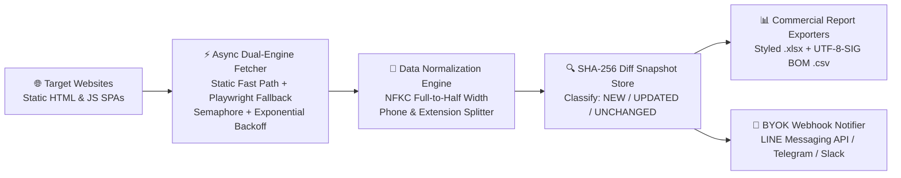

# Resilient Python Web Scraper & Automated Data Diff Pipeline
### 雙引擎高韌性 Python 爬蟲、全半形清洗、增量異動比對（Diff）與 Excel / LINE 自動化報表管線

[](./tests/test_pipeline.py)
[](./src/scraper_pipeline/)
[](./src/scraper_pipeline/exporters.py)
[](https://github.com/EricTsaiQA)

> **English Summary:** A production-ready, zero-LLM-token Python web scraping and incremental ETL pipeline built by **Eric Tsai (`EricTsaiQA`)**. Combines an **Async Dual-Engine Fetcher (`urllib/httpx` fast path + `Playwright` SPA fallback)**, **NFKC Full-Width & Phone/Extension Normalization**, **SHA-256 Incremental Change Detection (`NEW` / `UPDATED` / `UNCHANGED`)**, **Commercial-Grade Excel (`.xlsx`) & BOM-Safe CSV Exporters**, and **BYOK LINE / Telegram / Slack Webhook Alerts**.
>
> **繁體中文簡介：** 由資深自動化工程師 **Eric Tsai (`EricTsaiQA`)** 打造的高韌性 Python 爬蟲與自動化資料清洗管線。具備 **雙引擎非同步擷取（靜態高速抓取 + Playwright 動態渲染降級）**、**台灣機關/企業全半形電話與分機自動正規化**、**SHA-256 增量異動比對（自動標記新增 `NEW` / 異動 `UPDATED` / 未變 `UNCHANGED`）**、**Windows Excel 零亂碼 `utf-8-sig` CSV 與自動高亮上色 `.xlsx` 報表匯出**，以及 **LINE Messaging API / Telegram 異動推播通知**。

---

## 🤖 Half-Human, Half-AI Collaborative Studio｜一半真人、一半 AI 的協作團隊｜人間とAIの協働スタジオ

We believe in **100% engineering transparency (誠實為上策)**:
- 👨‍💻 **Human-in-the-Loop & 100% Human Accountability (真人資深架構與驗收把關)**: Senior QA & Data Automation Architect **Eric Tsai** personally designs the anti-blocking concurrency strategy, inspects legacy SSL/encoding edge cases, verifies data accuracy row-by-row, and guarantees **zero runtime LLM token waste** on structured DOM targets.
- ⚡ **AI Multi-Agent Velocity (AI 多代理協作加速)**: Specialized AI agents rapidly analyze heterogeneous site DOM structures across dozens of portals, synthesize normalization regexes, and generate unit test fixtures—enabling us to deliver **real extracted sample spreadsheets upfront** before you even award the contract.

---

## 🏗️ End-to-End ETL Pipeline Architecture (系統架構圖)



---

## ✨ Key Engineering Features (核心工程亮點)

1. **Zero Runtime Token Cost (`$0.00` LLM Bill)**:
   - Uses deterministic DOM parsing and SHA-256 content fingerprinting so daily scheduled cron jobs run 100% free on GitHub Actions or a lightweight VPS.
2. **Taiwan & APAC Directory Normalization (`src/scraper_pipeline/models.py`)**:
   - Automatically normalizes full-width strings like `（０４）２２２８－９１１１ 轉 22100` into `(04)2228-9111` and extension `22100`.
3. **Incremental Diff Highlighting (`src/scraper_pipeline/diff_store.py` & `exporters.py`)**:
   - Tracks state across runs and highlights `NEW` rows in soft green (`#E6F4EA`) and `UPDATED` rows in soft amber (`#FEF7E0`) inside the exported Excel workbook.
4. **Windows Excel BOM-Safe CSV (`utf-8-sig`)**:
   - Eliminates Traditional Chinese / Japanese garbled text (亂碼) when business users double-click `.csv` files in Microsoft Excel on Windows.

---

## 📂 Repository Structure (專案目錄結構)

```text
resilient-web-scraper-pipeline/
├── .github/workflows/scheduled-scraper.yml  # Daily cron GitHub Actions workflow
├── examples/
│   ├── run_demo_pipeline.py                 # Runnable E2E demo script
│   └── output/
│       ├── demo_directory_report.csv        # Generated UTF-8-SIG BOM CSV report
│       └── demo_directory_report.xlsx       # Generated styled Excel report
├── src/scraper_pipeline/
│   ├── __init__.py
│   ├── models.py                            # NFKC & phone/extension normalization schema
│   ├── engine.py                            # Async static + Playwright fallback fetcher
│   ├── diff_store.py                        # SHA-256 NEW / UPDATED / UNCHANGED tracker
│   ├── exporters.py                         # openpyxl styled .xlsx & utf-8-sig .csv exporter
│   └── notifiers.py                         # BYOK LINE / Telegram / Slack webhook notifier
├── tests/
│   └── test_pipeline.py                     # Comprehensive pytest suite (100% passing)
├── pytest.ini
├── requirements.txt
└── LICENSE
```

---

## 🚀 Quickstart (快速執行與產出報表)

```bash
# 1. Install dependencies
pip install -r requirements.txt

# 2. Run the end-to-end demo pipeline (generates CSV & Excel in examples/output/)
python3 examples/run_demo_pipeline.py

# 3. Run the automated pytest verification suite
pytest -v
```

### Sample Demo Execution Output
```text
🔔 [Gov & Enterprise Directory Tracker] Automated Data Pipeline Alert
• Total Scanned: 3
• 🟢 NEW: 1 | 🟡 UPDATED: 1 | ⚪ UNCHANGED: 1
  - [NEW] 臺中市 臺中市政府 數位發展局 ((04)2228-9111 ext.22100)
  - [UPDATED] 苗栗縣 苗栗縣政府 工商發展處 ((037)322-150 ext.5128)
Exported CSV:  examples/output/demo_directory_report.csv (764 bytes)
Exported XLSX: examples/output/demo_directory_report.xlsx (5748 bytes)
```

---

## 📬 Author & Consulting Contact
- **Eric Tsai (`EricTsaiQA`)** — Senior QA Automation Architect & Full-Stack Indie Developer
- 🌐 Website: [https://e3t4fun.com](https://e3t4fun.com) · 📧 Email: [e3t4fun@gmail.com](mailto:e3t4fun@gmail.com)
